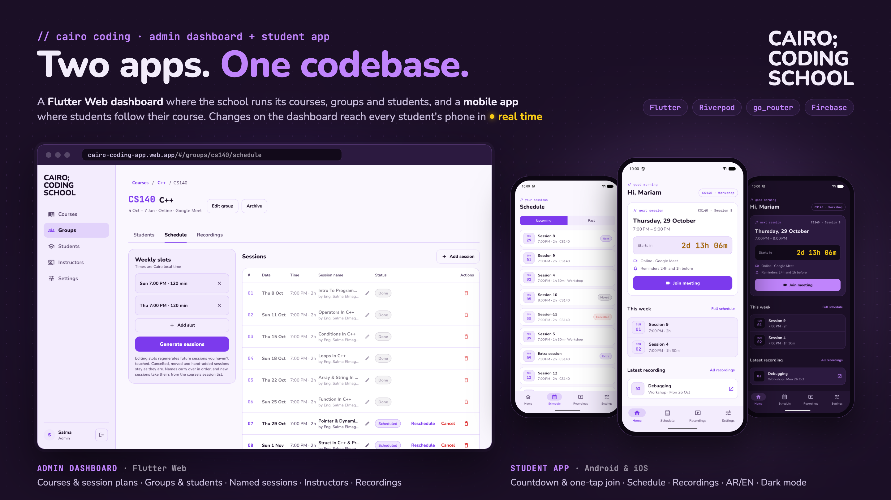
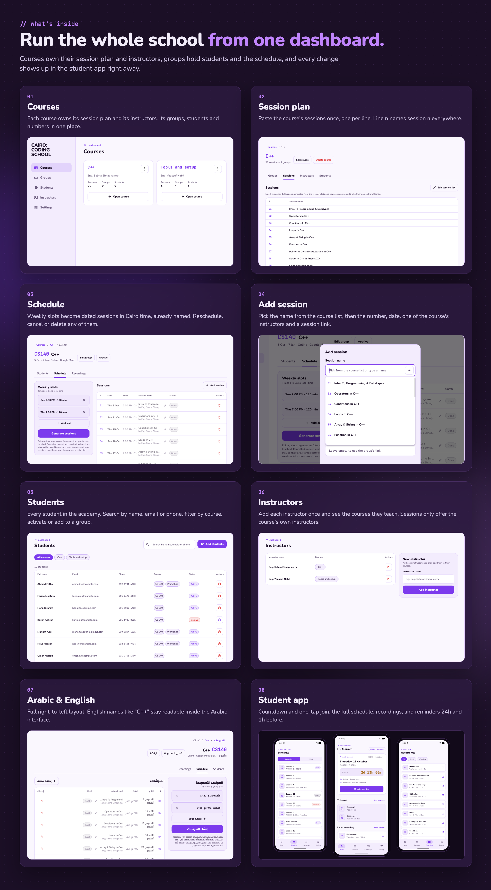
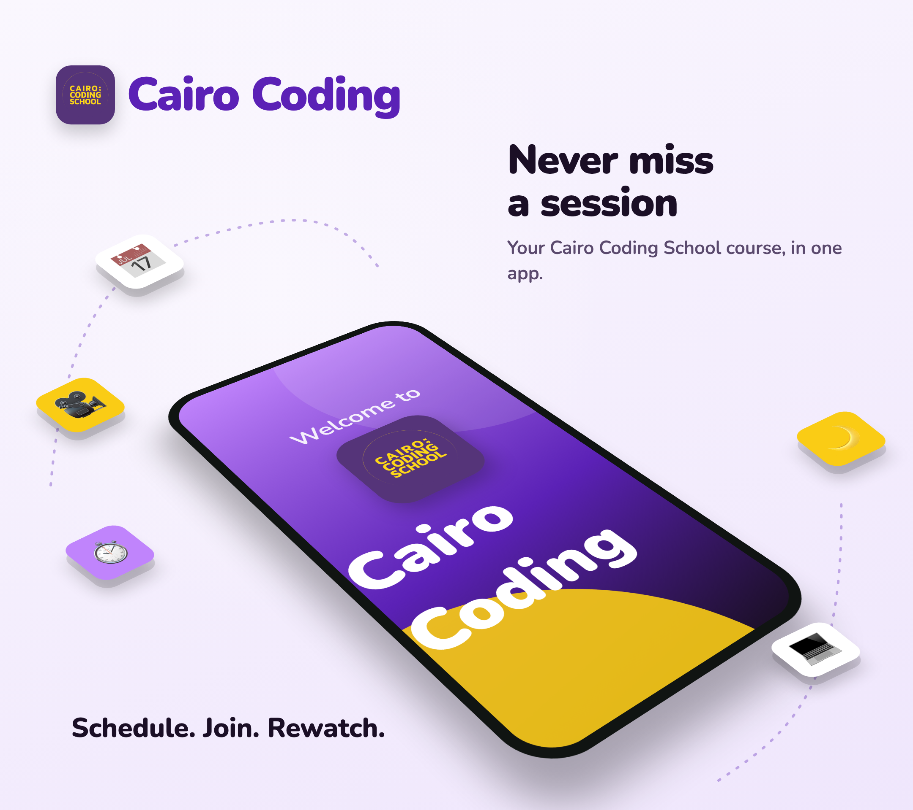

# Cairo Coding — Admin Dashboard & Student App

A Flutter Web admin dashboard and a mobile student app for **Cairo Coding School**, built from one codebase on Firebase.



- **Admin dashboard:** https://cairo-coding-app.web.app (admins only)
- **Demo video:** https://youtu.be/3QkZTTSbrbQ
- **System design (Miro):** https://miro.com/app/board/uXjVEd9BKNo=/?share_link_id=122107319382

## Features



**Admin dashboard (Flutter Web)**
- **Courses.** Each course owns its session plan (pasted once, one session per line) and its instructors. Its page shows its groups, the numbered plan, its instructors and every student in its groups.
- **Groups.** Create, edit and archive groups. Each group belongs to a course and has its own meeting link, location and dates.
- **Schedule.** Set weekly time slots and generate the group's sessions, named in order from the course's plan. Reschedule, cancel, restore or delete any session.
- **Add session.** Add a session by hand: name from the course list (or typed), number, date and time, one of the course's instructors, and its own meeting link. Hand-added sessions are never replaced when the slots are regenerated.
- **Students.** Every student in the academy in one table: search by name, email or phone, filter by course, open their groups, activate or deactivate accounts. Enroll students one by one or by pasting a list of emails. New emails get an account and a set-password email; existing accounts are just added to the group.
- **Instructors.** Add each instructor once, see the courses they teach, and add them to courses.
- **Recordings.** Add, edit and delete session recordings (YouTube or Google Drive links).

**Student app (Android / iOS)**
- Next session with its name and instructor, a live countdown and a one-tap "Join meeting".
- Full schedule with upcoming and past sessions, with moved, cancelled and extra sessions marked.
- Recordings, filterable by group.
- Session reminders 24 hours and 1 hour before, kept in step with schedule changes by a background sync every 6 hours.
- Arabic / English and light / dark / system theme.



## Technical highlights

- **One codebase, two apps.** `lib/main_admin.dart` and `lib/main_student.dart` each have their own router, so the student app never compiles admin code.
- **Riverpod** for state: Firestore reads are real-time streams exposed through `StreamProvider`s, derived state is plain `Provider`s, and `select` keeps rebuilds small.
- **go_router** with a single auth guard (splash → login → blocked / home) and shareable dashboard URLs such as `/courses/:courseId/sessions` and `/groups/:groupId/schedule`.
- **Scheduling engine** that turns weekly slots into dated sessions in Africa/Cairo time, correct across daylight saving. It names new sessions from the course plan and only regenerates sessions nobody has touched.
- **No server code (Firebase Spark plan).** Student accounts are created from the dashboard through a secondary Firebase app, so the admin stays signed in, and a password-reset email works as the welcome email.
- **Role-based Firestore security rules:** admins are listed in `admins/{uid}`, courses and instructors are admin-only with checked fields, and students can only read their own groups while their account is active.
- **Offline cache** turned on to cut reads and keep the app usable on a weak connection.
- **Repository layer with swappable data sources.** Firebase in the app, an in-memory fake in tests. Errors are mapped to typed, translated messages through a sealed `Result` type.
- **Arabic and English** with full right-to-left layout. English names such as "C++" or "OOP (Encapsulation)" are wrapped in Unicode isolates so they don't flip inside Arabic text.
- **Cache-safe web deploys.** A predeploy hook renames the tree-shaken icon font after its content, so browsers never show new icons blank from an older cached font.
- Bundled fonts (Nunito, Cairo, JetBrains Mono) and a responsive sidebar / drawer layout.

## Tech stack

Flutter · Dart · Flutter Web · Riverpod · go_router · Firebase Auth · Cloud Firestore · Firestore Security Rules · Firebase Hosting · easy_localization · timezone · flutter_animate

## Project structure

```
lib/
├── main_student.dart / main_admin.dart
├── core/      theme, fonts, assets, errors + Result, bidi helper, shared widgets, animations
├── data/      models, sources (Firestore / Auth), fake backend for tests, repositories
├── shared/    login, splash, blocked screen, preferences, routing guard, session labels
├── student/   student router and tabs (home, schedule, recordings, settings)
└── admin/     admin router, sidebar shell, courses, groups, students, instructors, settings
```

More detail in [docs/code-notes.md](docs/code-notes.md).

## Running it

```bash
flutter pub get

# Student app (pick an Android emulator or iOS simulator)
flutter run -t lib/main_student.dart

# Admin dashboard
flutter run -d chrome -t lib/main_admin.dart
```

In VS Code, use the **Student (iOS / Android)** and **Admin (Web)** launch configurations.

Admins are whoever has a document at `admins/{uid}` in Firestore. That document can only be created from the Firebase console.

## Firebase

- Project: `cairo-coding-app` (Spark plan)
- Deploy security rules: `firebase deploy --only firestore`
- Deploy the dashboard: `flutter build web -t lib/main_admin.dart && firebase deploy --only hosting` (the predeploy hook in `firebase.json` renames the icon font)

## Tests

```bash
flutter test
```

- Auth redirect rules and the scheduling engine, including the daylight-saving change.
- Session names from the course plan, hand-added sessions surviving regeneration, and course students listed once.
- End-to-end tests that boot each app on the fake backend, sign in, and walk through the screens: courses and their tabs, the session form, the students page, instructors, and the student app tabs.

The images in this README are rendered from the app itself with the fake backend: `docs/readme/screens/` holds the dashboard screens, and `docs/readme/hero.html` and `features.html` lay them out.

## Status

The admin dashboard is live on Firebase Hosting and the student app is ready for Google Play. Store assets, listing text and the release checklist are in `store/`. Next up: quizzes and grades for students.
